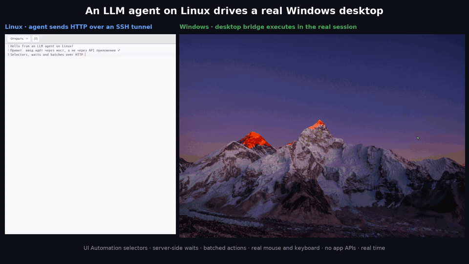
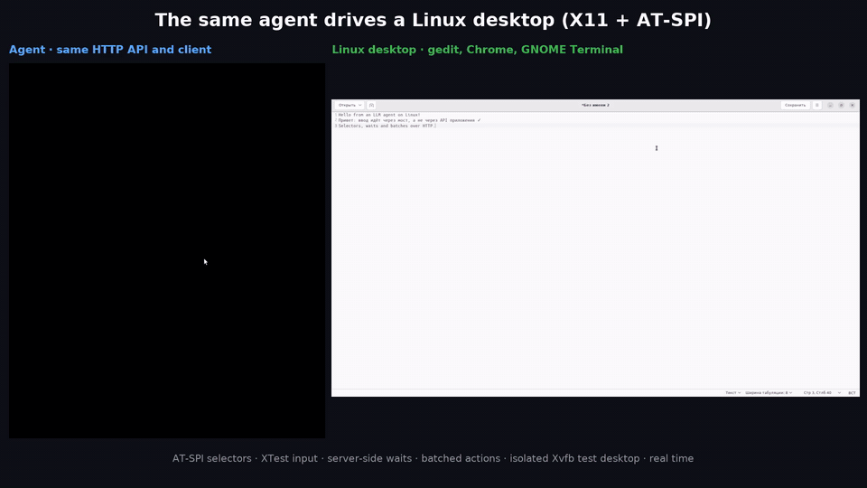
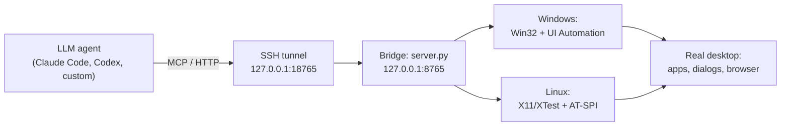

# LLM Computer Use Bridge

**A bridge that lets an AI agent drive a real Windows or Linux desktop over HTTP and MCP.** The agent runs anywhere — a Linux server, a container, a laptop — while the bridge on the target machine clicks, types, reads the UI tree (UI Automation / AT-SPI) and takes screenshots in the live user session.

[Русская версия](README.md)




*Left: an agent on Linux sends HTTP requests through an SSH tunnel. Right: the real Windows desktop where the bridge executes them. Real time, no editing.* [MP4 video](docs/media/bridge-demo-windows.mp4)

## Why

Coding agents such as Claude Code and Codex are great with code and terminals, but many tasks only exist in a GUI: desktop apps, system dialogs, programs without an API, Electron and WebView apps. Typical computer-use setups are tied to one model and work "by eye": screenshot → coordinates → click. That is slow, expensive in tokens and fragile.

The bridge gives the agent **text-first** access to the UI:

- windows, elements and their values come from the accessibility tree, not from pixels;
- clicks and input target selectors (`automation_id`, `name`, `role`), not coordinates;
- the server waits for an element to appear, become enabled or disappear;
- several steps with waits in between go out as one HTTP request;
- screenshots only when nothing else will do.

It is model-agnostic: an HTTP API plus an MCP server, usable from any agent that can call tools.

## Features

| Area | What you get |
|---|---|
| Windows | Top-level windows and popup menus with owners, active window, focus, drag, snap |
| UI tree | `inspect` a window or one element by selector: role, name, `automation_id` (DOM `id` in browsers), value, bounds, state |
| Input | Click an element or a point, `set_value`, Unicode keyboard input with value verification, shortcuts, scroll, physical drag |
| Waits | `wait_for` a selector: `exists`, `visible`, `enabled`, `absent`, exact value — standalone or as a batch step |
| Batches | Up to 64 steps per request; a timed-out wait stops the batch with a clear error and the list of completed steps |
| Screenshots | Active window or whole desktop, JPEG/PNG, coordinate scale, point hit-test |
| Launching | `launch_app` with arguments. Windows: ordinary user rights by default, admin only with explicit `elevated:true` |
| Safety | Token auth, `127.0.0.1` only, an exclusive desktop lease, a hit-test before every click so input never lands in a foreign window |

Platforms:

- **Windows 10/11** — Win32 + UI Automation, in the interactive user session; can also drive elevated apps such as Registry Editor.
- **Linux (X11)** — EWMH + XTest + AT-SPI2 behind the same API, plus an isolated Xvfb test desktop.



[MP4 video](docs/media/bridge-demo-linux.mp4)

## Architecture



MCP tools: `desktop_status`, `desktop_windows`, `desktop_inspect`, `desktop_wait_for`, `desktop_observe`, `desktop_lease`, `desktop_actions`, `desktop_release`. Agent rules live in [AGENTS.md](AGENTS.md).

## Numbers

The same 8-block scenario (Notepad, clipboard, a WebView2 web app, Registry Editor, Docker Desktop with its CLI, window drags), run by Claude Opus 5.5 as the bridge evolved:

| | First version | Server-side waits | Waits inside batches | Linux backend |
|---|---|---|---|---|
| Wall time | 12:04 | 8:30 | **5:54** | 2:21 |
| Score / 100 | 99 | 100 | 100 | 99 |
| Model steps | 91 | 51 | **30** | 10 |
| `inspect` calls | 98 | ~17 | **7** | 2 |
| Screenshots | 29 | 15 | 13 | 8 |

The Linux run used an equivalent scenario (gedit, Chrome, terminal, a system file dialog) without slow real-world apps, so compare steps rather than seconds.

## Quick start

**Windows (bridge):** Python 3.10+, an unlocked user session.

```powershell
python -m venv .venv
.venv\Scripts\python.exe -m pip install -r requirements.txt
start.cmd    # one UAC prompt; listens on 127.0.0.1:8765, writes access.token
```

**Agent machine:**

```bash
ssh -N -L 18765:127.0.0.1:8765 user@windows-host &
python3 client.py --url http://127.0.0.1:18765 status
python3 -m venv .venv && .venv/bin/pip install -r requirements-mcp.txt
.venv/bin/python configure_mcp.py --token-file ./access.token   # MCP config without the token itself
```

**Linux (bridge for X11):**

```bash
sudo apt install python3-gi gir1.2-atspi-2.0 at-spi2-core python3-xlib python3-pil
scripts/linux/start-linux.sh
# isolated test desktop:
sudo apt install xvfb openbox
scripts/linux/test-desktop-up.sh :99 && . /tmp/bridge-desktop99.env && scripts/linux/start-linux.sh --port 8766
```

The scripted tour from the videos is [`examples/demo_tour.py`](examples/demo_tour.py).

## Security and limits

- The token equals control of the desktop: keep it like an SSH key. The server binds to `127.0.0.1`; use an SSH tunnel.
- On Windows the bridge runs elevated; `launch_app` starts programs with ordinary rights unless `elevated:true` is set.
- UAC prompts and the lock screen live on the secure desktop: the bridge cannot see or click them, by design.
- Mouse and keyboard are shared with the human at the machine.
- `invoke` in Chromium/WebView2 may not run the click handler; the response says `effect_status: unconfirmed`. Prefer `click` + `wait_for` for web UIs.
- Linux: X11 only; on Wayland XTest reaches XWayland windows only.

## How it was built

Built in about a day by a pair of LLM agents directed by the author: Codex on the Windows machine wrote and fixed the Windows backend; Claude Code on Linux ran the scenarios through the tunnel, measured time and tokens, filed issues with reproduction steps, verified fixes on the live build, and wrote the Linux backend. The agents talked through this very bridge — Claude typed tasks into the Codex window on Windows.

## License

[MIT](LICENSE). Author: [@dermanov-ru](https://github.com/dermanov-ru).
