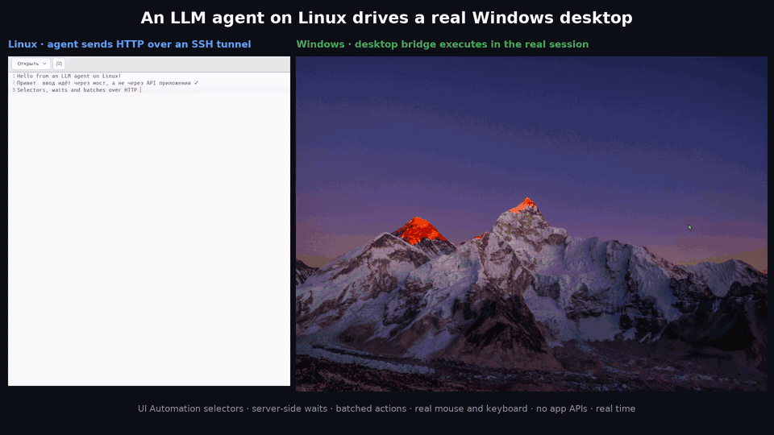
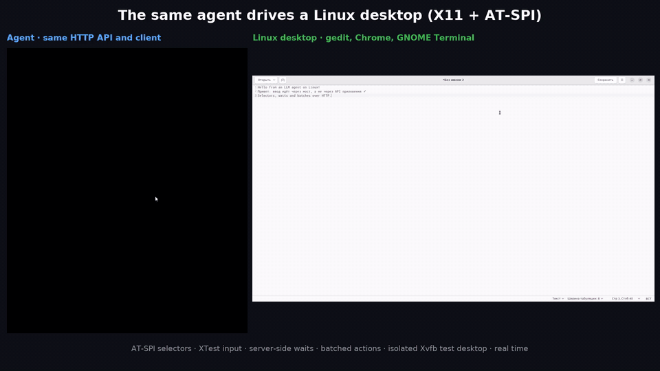
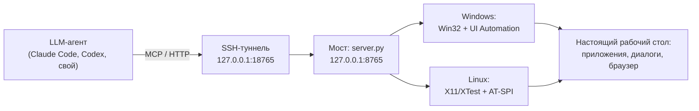

# LLM Computer Use Bridge

**Мост, через который ИИ-агент управляет настоящим рабочим столом Windows или Linux по HTTP и MCP.** Агент работает где угодно — на Linux-сервере, в контейнере, на ноутбуке, — а мост на целевой машине кликает, печатает, читает дерево интерфейса (UI Automation / AT-SPI) и делает скриншоты в живой пользовательской сессии.

[English version](README.en.md)




*Слева — агент на Linux шлёт HTTP-запросы через SSH-туннель. Справа — настоящий рабочий стол Windows, где мост их выполняет. Реальное время, без монтажа.* [Видео в MP4](docs/media/bridge-demo-windows.mp4)

## Зачем

Агенты вроде Claude Code и Codex отлично работают с кодом и терминалом, но многие задачи живут только в GUI: десктопные приложения, системные диалоги, программы без API, Electron и WebView. Готовые решения computer use обычно привязаны к своей модели и смотрят на экран «глазами»: скриншот → координаты → клик. Это медленно, дорого по токенам и ломается от любого сдвига.

Мост даёт агенту **текстовый** доступ к интерфейсу:

- окна, элементы и их значения читаются из дерева доступности, а не со скриншота;
- клик и ввод идут по селектору (`automation_id`, `name`, `role`), координаты не нужны;
- ожидание «пока появится / станет активной / исчезнет» выполняет сервер;
- несколько шагов с ожиданиями между ними уходят одним HTTP-запросом;
- скриншот — только когда без него не обойтись.

Мост не зависит от модели: это HTTP API плюс MCP-сервер. Подключается к любому агенту, который умеет вызывать инструменты.

## Что умеет

| Группа | Возможности |
|---|---|
| Окна | Список окон и всплывающих меню с владельцем, активное окно, фокус, перетаскивание, снап |
| Дерево интерфейса | `inspect` окна или элемента по селектору: роль, имя, `automation_id` (DOM `id` в браузере), значение, рамка, состояние |
| Ввод | Клик по элементу или точке, `set_value`, Unicode-ввод с клавиатуры со сверкой значения, сочетания клавиш, прокрутка, физический drag |
| Ожидание | `wait_for` по селектору: `exists`, `visible`, `enabled`, `absent`, точное значение. Отдельным вызовом или шагом внутри пакета |
| Пакеты | До 64 шагов в одном запросе; при таймауте ожидания пакет останавливается с понятной ошибкой и списком выполненных шагов |
| Снимки | Активное окно или весь стол, JPEG/PNG, коэффициент пересчёта координат, hit-test точки |
| Запуск программ | `launch_app` с аргументами. Windows: по умолчанию с правами пользователя, администратор только явным `elevated:true` |
| Безопасность | Токен, только `127.0.0.1`, аренда стола (lease) для одного агента, проверка «под курсором именно то окно» перед каждым кликом |

Платформы:

- **Windows 10/11** — Win32 + UI Automation. Работает в интерактивной сессии пользователя, умеет управлять и приложениями с правами администратора (regedit и т.п.).
- **Linux (X11)** — EWMH + XTest + AT-SPI2. Тот же API: агенту всё равно, какая ОС на той стороне. Есть изолированный тестовый стол на Xvfb.



*Тот же сценарий на Linux: gedit, Chrome и GNOME Terminal на изолированном столе Xvfb.* [Видео в MP4](docs/media/bridge-demo-linux.mp4)

## Как это устроено



- `server.py` — HTTP API, токен, аренда стола, ожидания, пакеты. Платформа выбирается автоматически.
- `win32_backend.py`, `uia_backend.py`, `launcher.py` — Windows.
- `linux_backend.py`, `atspi_backend.py` — Linux.
- `client.py` — клиент и CLI без зависимостей, работает с любой ОС.
- `mcp_adapter.py` — MCP-сервер поверх того же API: `desktop_status`, `desktop_windows`, `desktop_inspect`, `desktop_wait_for`, `desktop_observe`, `desktop_lease`, `desktop_actions`, `desktop_release`.

## Цифры

Один и тот же сценарий — 8 блоков, шесть приложений: Блокнот, буфер обмена, веб-приложение в WebView2, редактор реестра, Docker Desktop с CLI, перетаскивание окон. Его проходил агент Claude Opus 5.5, по мере доработки моста:

| | Первая версия | Ожидания на сервере | Ожидания в пакетах | Linux-версия |
|---|---|---|---|---|
| Время | 12:04 | 8:30 | **5:54** | 2:21 |
| Баллы из 100 | 99 | 100 | 100 | 99 |
| Шагов модели | 91 | 51 | **30** | 10 |
| Вызовов `inspect` | 98 | ~17 | **7** | 2 |
| Скриншотов | 29 | 15 | 13 | 8 |

Linux-версия проходила свой сценарий-аналог (gedit, Chrome, терминал, системный диалог) без медленных реальных приложений, поэтому её время напрямую не сравнить; показательнее число шагов.

Главный выигрыш дал перенос ожиданий на сервер: блок «создать раздел реестра и строковый параметр» стал одним запросом из 19 шагов вместо десятка опросов.

## Быстрый старт

### 1. Windows: запустить мост

Нужен Python 3.10+ и открытая (не заблокированная) сессия пользователя.

```powershell
git clone <этот репозиторий>
cd <папка репозитория>
python -m venv .venv
.venv\Scripts\python.exe -m pip install -r requirements.txt
start.cmd
```

`start.cmd` один раз запросит UAC: мост работает с правами администратора, чтобы управлять и такими окнами. Сервер слушает только `127.0.0.1:8765`, токен появится в `access.token`.

### 2. Агент: подключиться

С машины агента пробросьте порт по SSH и передайте токен защищённым способом:

```bash
ssh -N -L 18765:127.0.0.1:8765 user@windows-host &
scp user@windows-host:path/to/access.token ./access.token && chmod 600 access.token

python3 client.py --url http://127.0.0.1:18765 status
python3 client.py --url http://127.0.0.1:18765 windows
```

Для MCP-клиента сгенерируйте конфиг (токен не попадёт в файл, только путь к нему):

```bash
python3 -m venv .venv && .venv/bin/pip install -r requirements-mcp.txt
.venv/bin/python configure_mcp.py --token-file ./access.token
# скопируйте запись из mcp.local.json в конфиг вашего агента
```

Правила для агента — в [AGENTS.md](AGENTS.md): как выбирать селекторы, когда нужен скриншот, что делать при 409/422.

### 3. Linux: мост для X11

```bash
sudo apt install python3-gi gir1.2-atspi-2.0 at-spi2-core python3-xlib python3-pil
scripts/linux/start-linux.sh            # управляет текущей X11-сессией
```

Изолированный тестовый стол, который не трогает ваш экран:

```bash
sudo apt install xvfb openbox
scripts/linux/test-desktop-up.sh :99    # Xvfb + свой D-Bus + AT-SPI + openbox
. /tmp/bridge-desktop99.env
scripts/linux/start-linux.sh --port 8766
```

## Пример: пакет с ожиданиями

Заполнить поле, выбрать группу, нажать «Add» и дождаться строки в списке — одним запросом:

```json
{"lease_id": "…", "actions": [
  {"type": "set_value", "window_id": 12345, "selector": {"automation_id": "domInput"}, "text": "agent-demo.example"},
  {"type": "click_element", "window_id": 12345, "selector": {"automation_id": "domGroup"}},
  {"type": "press_keys", "window_id": 12345, "keys": ["DOWN"]},
  {"type": "press_keys", "window_id": 12345, "keys": ["ENTER"]},
  {"type": "wait_for", "window_id": 12345, "selector": {"automation_id": "btnDom"}, "state": "enabled", "timeout": 10},
  {"type": "click_element", "window_id": 12345, "selector": {"automation_id": "btnDom"}},
  {"type": "wait_for", "window_id": 12345, "selector": {"role": "listitem", "name": "agent-demo.example✕"}, "timeout": 10}
]}
```

Полный сценарий из видео — [`examples/demo_tour.py`](examples/demo_tour.py), тестовое веб-приложение — [`examples/demo-app`](examples/demo-app/index.html).

## API

| Запрос | Что делает |
|---|---|
| `GET /v1/status` | Версия, `build_id`, права, доступность рабочего стола |
| `GET /v1/windows?include_popups=true&owner=ID` | Окна верхнего уровня и всплывающие меню |
| `POST /v1/inspect` | Дерево окна или один элемент по `selector` |
| `POST /v1/wait_for` | Ожидание элемента без аренды и без скриншотов |
| `POST /v1/observe` | Скриншот окна или стола, hit-test точки |
| `POST /v1/lease` / `POST /v1/release` | Эксклюзивная аренда стола |
| `POST /v1/actions` | Пакет действий: `launch_app`, `focus_window`, `click`, `click_text`, `click_element`, `set_value`, `type_text`, `press_keys`, `scroll`, `move`, `drag`, `wait_for` |

Коды ошибок: 400 — неверный запрос (до ввода), 401 — нет токена, 408 — истекло ожидание в пакете, 409 — аренда занята или под точкой чужое окно, 422 — элемент не найден или неоднозначен, 423 — стол заблокирован или открыт UAC.

## Безопасность и ограничения

- **Токен = управление рабочим столом.** Храните его как SSH-ключ, передавайте только защищённым каналом. Сервер слушает только `127.0.0.1`, доступ снаружи — через SSH-туннель.
- На Windows мост работает с правами администратора. `launch_app` по умолчанию запускает программы с обычными правами пользователя; права администратора — только явным `elevated:true`.
- Окно UAC и экран блокировки мост не видит и не нажимает: это защищённый рабочий стол Windows. Такие места оставлены человеку.
- Мышь и клавиатура общие с человеком. Аренда защищает от второго агента, но не от человека за компьютером.
- `invoke` в Chromium/WebView2 может не вызвать обработчик: ответ честно помечает его `effect_status: unconfirmed`. Для веб-интерфейсов надёжнее `click` + `wait_for`.
- Linux: только X11. На Wayland XTest достаёт лишь до окон XWayland.

## Как проект делался

Мост собран примерно за сутки в паре LLM-агентов под управлением автора:

- **Codex** на Windows-машине писал и чинил Windows-часть.
- **Claude Code** на Linux прогонял сценарии через туннель, замерял время и токены, находил баги и заводил на них issue с шагами воспроизведения. Codex исправлял, Claude проверял исправление на живой сборке. Так прошло около десяти циклов «issue → исправление → проверка».
- Linux-версию Claude Code написал и проверил на изолированном столе Xvfb.

Агенты общались через этот же мост: Claude на Linux печатал задачи в окно Codex на Windows.

## Тесты

```bash
python3 -m unittest test_bridge test_linux_backend
```

Тесты детерминированные, без ввода и без изменения приложений. Windows-специфичные тесты на Linux пропускаются.

## Лицензия

[MIT](LICENSE). Автор — [@dermanov-ru](https://github.com/dermanov-ru).
